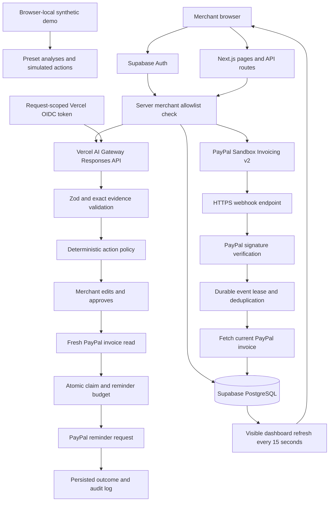

# Architecture

## State ownership

PayPal owns invoice payment state, balances, and recipient payment links. The application owns approval state, pauses, payment promises, message provenance, and audit records.

AI output supplies evidence-backed classification and draft text. A fixed mapping chooses permitted actions. The backend controls all authorizations and outgoing notifications.

## Consistency

Operation IDs and payload hashes identify create and send attempts. Recommendation IDs identify outgoing reminder attempts. PostgreSQL row and advisory locks serialize approval and budget claims. Settled and pending payment reconciliation blocks pending recommendations. Started or uncertain outgoing actions remain visible for manual reconciliation.

Webhook event IDs are unique. Leases prevent concurrent processing, failures can retry, and completed events deduplicate. Reconciliation timestamps prevent an older fetch from overwriting a later completed fetch. Terminal payment states have an additional guard against unconfirmed reopening.

## Deployment

The application is deployed at https://invoicerescue-ai.vercel.app/ with Singapore Vercel Functions, Node.js 24.x, and pnpm 11.25.0. Supabase is hosted separately. Hosted analysis calls Vercel AI Gateway using openai/gpt-4.1-mini and resolves a fresh request-scoped OIDC token through @vercel/oidc. The optional local proxy configuration remains separate from the hosted runtime. PayPal Sandbox notifications target /api/paypal/webhook. All secrets belong to server configuration; browser reads remain protected by ownership RLS.
